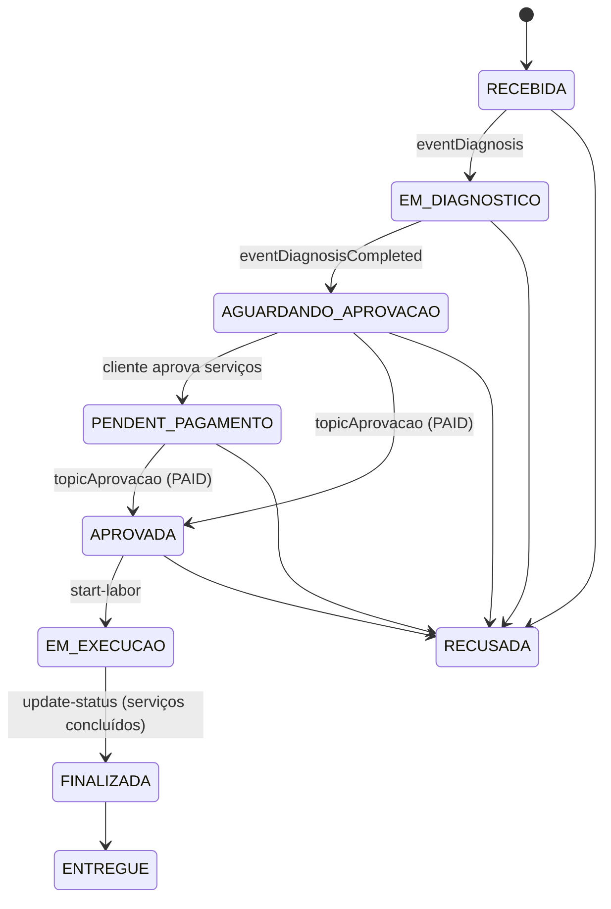
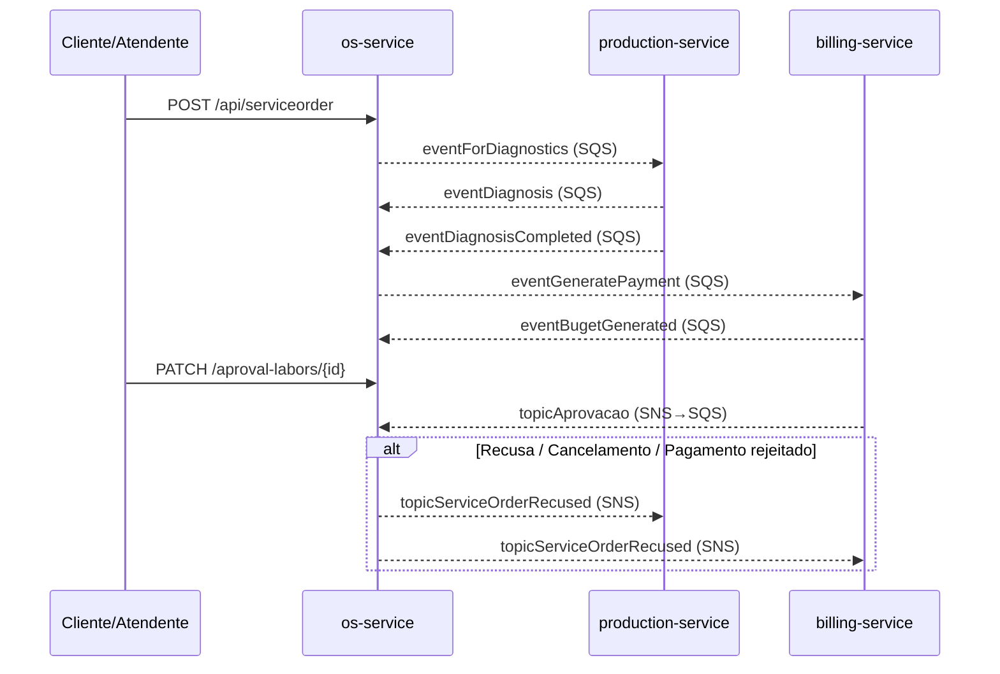

# 🛠️ Officyna - Microsserviço de Ordem de Serviço (OS)

> **Tech Challenge - Fase 4: Desacoplamento e Arquitetura de Microsserviços**

O **`officyna-os-service`** é o microsserviço responsável pelo núcleo de atendimento da oficina e pelo ciclo de vida da **Ordem de Serviço (OS)**. Ele gerencia clientes, veículos e o fluxo operacional das ordens, além de **orquestrar a SAGA** de diagnóstico → orçamento → aprovação/pagamento → execução, comunicando-se de forma assíncrona (Amazon SQS / SNS) com os serviços de **Produção** (`officyna-execution-production`) e **Faturamento** (`officyna-billing-service`).

---

## 📋 Sumário
* [Objetivo do Microsserviço](#-objetivo-do-microsserviço)
* [Stack Tecnológica](#-stack-tecnológica)
* [Domínios e Funcionalidades](#-domínios-e-funcionalidades)
* [Ciclo de Vida da OS](#-ciclo-de-vida-da-os)
* [Mensageria e SAGA](#-mensageria-e-saga)
* [Endpoints REST](#-endpoints-rest)
* [Autenticação e Autorização](#-autenticação-e-autorização)
* [Arquitetura e Organização de Pacotes](#-arquitetura-e-organização-de-pacotes)
* [Persistência NoSQL](#-persistência-nosql)
* [Observabilidade](#-observabilidade)
* [Instruções de Execução](#-instruções-de-execução)
* [Variáveis de Ambiente](#-variáveis-de-ambiente)
* [Testes e Qualidade](#-testes-e-qualidade)
* [CI/CD e Deploy (Kubernetes / EKS)](#-cicd-e-deploy-kubernetes--eks)

---

## 🎯 Objetivo do Microsserviço

* **Isolamento de Domínio:** gerencia exclusivamente **Ordem de Serviço**, **Cliente** e **Veículo**.
* **Desacoplamento:** Estoque (`supplies`), Mão de Obra (`labors`), Usuários internos (autenticação) e Faturamento foram externalizados para seus próprios microsserviços. A comunicação é feita por **eventos assíncronos (SQS/SNS)** e, pontualmente, por HTTP (consulta de mão de obra no serviço de Produção).
* **Persistência isolada:** banco MongoDB / Amazon DocumentDB próprio, apenas com as coleções do serviço.

---

## 🧰 Stack Tecnológica

| Camada | Tecnologia |
| :--- | :--- |
| Linguagem / Runtime | Java 21 |
| Framework | Spring Boot 4.0.x (Web, Data MongoDB, Security, Validation, Actuator) |
| Banco de dados | MongoDB 7 (local) / Amazon DocumentDB (AWS) |
| Mensageria | AWS SDK v2 — Amazon SQS e Amazon SNS (LocalStack em ambiente local) |
| Segurança | Spring Security + JWT stateless (`jjwt` 0.12) |
| Documentação | springdoc-openapi (Swagger UI) |
| Mapeamento | MapStruct + Lombok |
| Observabilidade | Logs JSON (`logstash-logback-encoder`), New Relic APM, Correlation ID |
| Testes | JUnit 5, Mockito, Spring Security Test, Testcontainers (MongoDB) |
| Qualidade | JaCoCo (≥ 80%), SonarCloud, OWASP Dependency-Check |
| Gateway | Kong 3.8 (modo declarativo/DB-less) |
| Deploy | Docker (multi-stage), GHCR, Kubernetes (Amazon EKS) com HPA |

---

## ✨ Domínios e Funcionalidades

### 1. Ordem de Serviço (`domain.serviceorder`)
* Abertura de OS (com cliente e veículo existentes ou novos) e numeração sequencial amigável.
* Inclusão/remoção de **serviços (labors)** — validados no serviço de Produção via HTTP — e de **peças (supplies)** como referências desacopladas.
* Início/finalização de cada serviço durante a execução (o primeiro serviço iniciado coloca a OS `EM_EXECUCAO`; a OS só pode ser `FINALIZADA` quando todos os serviços não rejeitados estiverem concluídos).
* Aprovação/rejeição de serviços pelo **cliente** (individualmente). Se todos forem rejeitados, a OS é **recusada**.
* Aplicação do **orçamento** e dos dados de pagamento (link, QR Code PIX) recebidos do Faturamento.
* Cancelamento da OS (permitido enquanto não estiver em execução) com publicação de **compensação SAGA**.
* Log estruturado de cada transição de status e de sua duração.

### 2. Clientes (`domain.customer`)
* CRUD de clientes Pessoa Física e Jurídica, com exclusão lógica.
* Validação de CPF/CNPJ (Módulo 11) via anotação `@ValidDocument`.

### 3. Veículos (`domain.vehicle`)
* CRUD de veículos vinculados a clientes.
* Validação de placa (padrão antigo e Mercosul).

---

## 🔄 Ciclo de Vida da OS

Status definidos em `ServiceOrderStatus`:

| ID | Status | Descrição |
| :-: | :--- | :--- |
| 1 | `RECEBIDA` | OS aberta; evento `eventForDiagnostics` publicado para a Produção |
| 2 | `EM_DIAGNOSTICO` | Mecânico iniciou o diagnóstico (evento `eventDiagnosis`) |
| 3 | `AGUARDANDO_APROVACAO` | Diagnóstico concluído; orçamento enviado ao cliente |
| 9 | `PENDENT_PAGAMENTO` | Cliente aprovou os serviços; aguardando confirmação do pagamento |
| 6 | `APROVADA` | Pagamento aprovado (`topicAprovacao`) |
| 4 | `EM_EXECUCAO` | Primeiro serviço iniciado |
| 5 | `FINALIZADA` | Atualização manual após todos os serviços não rejeitados serem concluídos |
| 7 | `ENTREGUE` | Veículo entregue ao cliente |
| 8 | `RECUSADA` | Recusada pelo cliente, cancelada ou pagamento rejeitado/estornado |



> [!IMPORTANT]
> Uma OS **não pode ser recusada/cancelada** quando estiver `EM_EXECUCAO`, `FINALIZADA` ou `ENTREGUE`. Toda transição para `RECUSADA` (cancelamento, rejeição de todos os serviços, `update-status`, `topicAprovacao` com status de recusa ou `topicRejeicao`) publica a compensação no tópico SNS **`topicServiceOrderRecused`**.

---

## 📨 Mensageria e SAGA

O serviço atua como **orquestrador** da SAGA. Os listeners fazem *long polling* nas filas SQS (`AbstractSqsQueueListener`), desembrulham automaticamente envelopes SNS (`{"Type":"Notification","Message":...}`), propagam `correlationId` e `Authorization` via *message attributes* e, em caso de falha, reenviam a mensagem para a respectiva **DLQ**.

### Eventos publicados

| Destino | Tipo | Gatilho | Consumidor |
| :--- | :--- | :--- | :--- |
| `eventForDiagnostics` | SQS | Criação da OS | Produção |
| `eventGeneratePayment` | SQS | Diagnóstico concluído / aprovação dos serviços pelo cliente | Faturamento |
| `topicServiceOrderRecused` | SNS (Fan-out) | Qualquer transição para `RECUSADA` | Produção (fila `eventServiceOrderRecused`) e Faturamento (fila `eventServiceOrderRecusedPayment`) |

### Eventos consumidos

| Fila | Origem | Ação no os-service | DLQ |
| :--- | :--- | :--- | :--- |
| `eventDiagnosis` | Produção | `RECEBIDA → EM_DIAGNOSTICO` e vínculo do mecânico | `eventDiagnosisDlq` |
| `eventDiagnosisCompleted` | Produção | `→ AGUARDANDO_APROVACAO` e publica `eventGeneratePayment` | `eventDiagnosisCompletedDlq` |
| `eventBugetGenerated` | Faturamento | Aplica orçamento, impostos, link e QR Code de pagamento | `eventBugetGeneratedDlq` |
| `topicAprovacao` | Faturamento (SNS → SQS) | `PAID/APPROVED → APROVADA`; `RECUSED/REJECTED/CANCELED/REFUNDED → RECUSADA` | — |
| `topicRejeicao` | Faturamento (SNS → SQS) | Registra rejeição/estorno do pagamento e marca a OS como `RECUSADA` | — |



> [!NOTE]
> No startup, o `SqsQueueInitializer` garante a existência das filas/DLQs (`AWS_SQS_INIT_ENABLED=true`). Na AWS, filas, tópicos e assinaturas são provisionados pelo repositório **`officyna-infra-k8s`** (Terraform, `messaging.tf`).

---

## 🌐 Endpoints REST

Documentação interativa completa em **Swagger UI** (`/swagger-ui.html`).

### Ordem de Serviço — `/api/serviceorder` (🔒 JWT)

| Método | Rota | Descrição |
| :--- | :--- | :--- |
| `GET` | `/api/serviceorder` | Lista OS ativas ordenadas por prioridade de status |
| `GET` | `/api/serviceorder/{id}` | Busca OS por ID |
| `GET` | `/api/serviceorder/number/{serviceOrderNumber}` | Busca OS pelo número sequencial |
| `POST` | `/api/serviceorder` | Cria uma nova OS |
| `PATCH` | `/api/serviceorder/{id}` | Atualiza dados da OS |
| `DELETE` | `/api/serviceorder/{id}` | Exclui a OS |
| `PUT` | `/api/serviceorder/{id}/add-labors` | Adiciona serviços (validados na Produção) |
| `PUT` | `/api/serviceorder/{id}/remove-labors/{laborId}` | Remove um serviço |
| `PUT`/`PATCH` | `/api/serviceorder/{id}/add-supply` | Adiciona peças |
| `PUT` | `/api/serviceorder/{id}/remove-supply/{supplyId}` | Remove uma peça |
| `PUT`/`PATCH` | `/api/serviceorder/{id}/start-labor/{laborId}` | Inicia um serviço (OS `APROVADA`/`EM_EXECUCAO`) |
| `PUT`/`PATCH` | `/api/serviceorder/{id}/finish-labor/{laborId}` | Finaliza um serviço |
| `PATCH` | `/api/serviceorder/{id}/update-status/?status=` | Atualiza o status manualmente |
| `POST` | `/api/serviceorder/{id}/send-os` | Envia a OS ao cliente (`AGUARDANDO_APROVACAO`) |
| `POST`/`PATCH` | `/api/serviceorder/{id}/cancel` | Cancela a OS e publica a compensação |

### Área do Cliente — `/api/serviceorder` (🔓 público)

| Método | Rota | Descrição |
| :--- | :--- | :--- |
| `GET` | `/api/serviceorder/customer/{document}?status=` | Lista OS do cliente por CPF/CNPJ (filtro opcional por status) |
| `PATCH` | `/api/serviceorder/aproval-labors/{id}` | Cliente aprova/rejeita serviços (`APROVADO`/`REJEITADO`) |

### Clientes — `/api/customers` (🔒 JWT)
`GET /` · `GET /{id}` · `GET /document/{document}` · `POST /` · `PUT /{id}` · `DELETE /{id}`

### Veículos — `/api/vehicles` (🔒 JWT)
`GET /` · `GET /{id}` · `GET /customer/{customerId}` · `POST /` · `PUT /{id}` · `DELETE /{id}`

### Infraestrutura (🔓 público)
`GET /actuator/health` · `GET /swagger-ui.html` · `GET /api-docs`

---

## 🔐 Autenticação e Autorização

O serviço **não emite tokens**: ele apenas **valida JWTs (HS256)** assinados com o segredo compartilhado `JWT_SECRET`. A autenticação é *stateless* (`JwtAuthenticationFilter`):

| Origem do token | Identificação | Perfil atribuído |
| :--- | :--- | :--- |
| **`officyna-users-service`** (usuários internos: admin, atendente, mecânico) | `sub` = usuário; claim `roles` | Perfis do claim `roles` (`ROLE_*`) |
| **Lambda de autenticação de clientes** | `iss=officyna-auth`, `type=CUSTOMER`, `roles` contendo `CUSTOMER` ou claim `customerId` | `ROLE_CUSTOMER` (cliente precisa existir e estar ativo na base) |

Para chamar os endpoints protegidos, obtenha o token no serviço de usuários (ou na Lambda de clientes) e envie:
```http
Authorization: Bearer <SEU_TOKEN_JWT>
```
No Swagger UI, use o botão **Authorize** e cole o token.

> [!WARNING]
> O `JWT_SECRET` deve ser **idêntico** ao utilizado pelo emissor do token; caso contrário, todas as requisições protegidas retornarão `401`.

---

## 🏗️ Arquitetura e Organização de Pacotes

O projeto segue os princípios de **Clean Architecture** (Controllers → Adapters → Services/Use Cases → Gateways):

```
br.com.officyna/
├── api/                          # Adaptadores primários (HTTP REST)
│   ├── customer/                 # Interface OpenAPI, Controller, Handler e DTOs de Cliente
│   ├── vehicle/                  # Interface OpenAPI, Controller, Handler e DTOs de Veículo
│   └── serviceorder/             # APIs de OS (atendimento e área do cliente)
├── domain/                       # Núcleo de negócio
│   ├── customer/                 # Entidade, validação de documento, serviço, mapper, presenter
│   ├── vehicle/                  # Entidade, serviço, mapper, presenter
│   └── serviceorder/             # Entidade/máquina de estados, enums, DTOs, gateways, services
├── infrastructure/               # Adaptadores secundários e frameworks
│   ├── client/production/        # Cliente HTTP para consulta de mão de obra (Produção)
│   ├── config/                   # Security, Swagger, Mongo, AWS SQS/SNS, inicializador de filas
│   ├── converter/                # Conversores customizados (LocalDateTime)
│   ├── exception/                # Tratamento global de erros
│   ├── logging/                  # Correlation ID (filtro HTTP + MDC)
│   ├── messaging/                # Listeners SQS, publisher SQS/SNS e DTOs de eventos
│   ├── persistence/              # Documents, repositories, gateways e mappers MongoDB
│   └── security/                 # Filtro e serviço JWT, handlers 401/403
└── seed/                         # Carga inicial de clientes e veículos (DatabaseSeeder)
```

---

## 🗄️ Persistência NoSQL

Coleções exclusivas no **MongoDB / Amazon DocumentDB**:

| Coleção | Conteúdo |
| :--- | :--- |
| `service_orders` | Ordens de serviço (serviços, peças, orçamento, pagamento, datas de cada status) |
| `database_sequences` | Sequenciador atômico para o número amigável da OS |
| `customers` | Clientes (PF/PJ) |
| `vehicles` | Veículos |

Em ambiente local, os scripts de `db-seed/` são executados na criação do container MongoDB. A propriedade `database.seed.enabled=true` ativa o `DatabaseSeeder` da aplicação.

---

## 📈 Observabilidade

* **Logs estruturados em JSON** (`logback-spring.xml` + Logstash encoder), com eventos de transição de status (`SERVICE_ORDER_STATUS_CHANGED`) e duração em cada status.
* **Correlation ID:** lido dos headers `correlationId` / `X-Correlation-ID` (ou gerado), propagado no MDC, nas mensagens SQS/SNS e no New Relic.
* **New Relic APM:** agente Java embarcado na imagem Docker (`newrelic/`).
* **Health check:** `GET /actuator/health`.

---

## 🚀 Instruções de Execução

### Pré-requisitos
* **Java JDK 21+**
* **Docker** e **Docker Compose**
* **Maven 3.9+** (opcional — o projeto inclui o wrapper `mvnw` / `mvnw.cmd`)

### Opção A: Infraestrutura no Docker + Aplicação local (recomendado para desenvolvimento)

1. Suba a infraestrutura:
   ```bash
   docker compose up -d mongodb mongo-express localstack sqs-admin
   ```
   * **MongoDB:** `localhost:27018` (banco `officyna`)
   * **LocalStack:** `localhost:4566` — o script `localstack-init/init-sqs.sh` cria as filas `eventForDiagnostics`, `eventGeneratePayment`, `eventDiagnosis`, `eventDiagnosisCompleted`, `eventBugetGenerated` (com DLQs), `eventServiceOrderRecused`, `topicAprovacao`, `topicRejeicao` e o tópico SNS `topicServiceOrderRecused`.
   * **Mongo Express:** `http://localhost:8084` (`admin` / `admin`)
   * **SQS Admin:** `http://localhost:8088`

2. Execute a aplicação:
   ```bash
   # Windows
   .\mvnw.cmd spring-boot:run
   # Linux / macOS
   ./mvnw spring-boot:run
   ```

   Para popular clientes e veículos de teste:
   ```bash
   ./mvnw spring-boot:run -Dspring-boot.run.arguments="--database.seed.enabled=true"
   ```

> [!TIP]
> Para rodar sem LocalStack, defina `AWS_SQS_LISTENER_ENABLED=false` e `AWS_SQS_INIT_ENABLED=false`.

### Opção B: Stack completa via Docker Compose (Infra + App + Kong)
```bash
docker compose up -d --build
docker compose logs -f app
docker compose down
```

### Acessos locais

| Serviço | URL |
| :--- | :--- |
| API | `http://localhost:8080` |
| Swagger UI | `http://localhost:8080/swagger-ui.html` |
| OpenAPI JSON | `http://localhost:8080/api-docs` |
| Health check | `http://localhost:8080/actuator/health` |
| Mongo Express | `http://localhost:8084` |
| SQS Admin | `http://localhost:8088` |
| Kong Gateway *(Opção B)* | `http://localhost:8000/officyna` |

#### Inspecionando filas via terminal
```bash
docker exec -it officyna-os-service-localstack awslocal sqs list-queues
docker exec -it officyna-os-service-localstack awslocal sqs receive-message \
  --queue-url http://sqs.us-east-1.localhost.localstack.cloud:4566/000000000000/eventForDiagnostics
```

---

## ⚙️ Variáveis de Ambiente

| Variável | Padrão | Descrição |
| :--- | :--- | :--- |
| `SERVER_PORT` | `8080` | Porta HTTP |
| `MONGODB_URI` | `mongodb://localhost:27018/officyna` | Conexão com MongoDB/DocumentDB |
| `JWT_SECRET` | *(valor de desenvolvimento)* | Segredo compartilhado para validação dos JWTs |
| `JWT_EXPIRATION` | `86400000` | Expiração do token (ms) |
| `PRODUCTION_SERVICE_URL` | `http://localhost:8082` | URL do serviço de Produção (consulta de mão de obra) |
| `AWS_REGION` | `us-east-1` | Região AWS |
| `AWS_ENDPOINT` | `http://localhost:4566` | Endpoint LocalStack (vazio na AWS) |
| `AWS_ACCESS_KEY_ID` / `AWS_SECRET_ACCESS_KEY` | `test` | Credenciais AWS |
| `AWS_SQS_INIT_ENABLED` | `true` | Cria filas/DLQs no startup |
| `AWS_SQS_LISTENER_ENABLED` | `true` | Habilita os listeners SQS |
| `AWS_SQS_WAIT_TIME_SECONDS` | `5` | Long polling (s) |
| `AWS_SQS_POLL_DELAY_MS` | `2000` | Intervalo entre polls (ms) |
| `AWS_SNS_TOPIC_SERVICE_ORDER_RECUSED` | `topicServiceOrderRecused` | Tópico SNS de compensação (nome ou ARN) |
| `AWS_SQS_QUEUE_*` | nomes das filas | Sobrescrevem os nomes das filas/DLQs (ver `application.yml`) |

---

## 🧪 Testes e Qualidade

```bash
# Testes unitários e de integração
./mvnw clean test

# Build completo + verificação de cobertura JaCoCo
./mvnw clean verify
```
* Relatório de cobertura: `target/site/jacoco/index.html`.
* **Cobertura mínima:** 80% (regra do `jacoco-maven-plugin`, com exclusões de classes de configuração).
* **Suíte atual:** 400+ testes cobrindo domínio, controllers, listeners/publishers de mensageria, segurança e persistência.

Análise SonarQube local (opcional):
```bash
docker compose --profile sonar up -d sonarqube
./mvnw clean verify sonar:sonar -Dsonar.token=<SEU_TOKEN_SONAR>
```

---

## ☁️ CI/CD e Deploy (Kubernetes / EKS)

Pipeline em `.github/workflows/cicd.yml` (push/PR em `main` e `developer`, ou `workflow_dispatch`):

1. **Build e Testes** — `mvn verify` + SonarCloud (quando `SONAR_TOKEN` estiver configurado).
2. **Docker** — build multi-stage e push para `ghcr.io/officyna/officyna-os-service` (tags `sha-*`, branch e `latest`).
3. **Deploy no EKS** (`eks-officyna-service`, namespace `officyna`):
   * garante as filas `eventForDiagnostics` e `eventGeneratePayment` (com DLQs);
   * lê o endpoint do DocumentDB no SSM (`/officyna/db/endpoint`);
   * aplica Kong, ConfigMap, Secret, Deployment, Service e HPA (1–3 réplicas, CPU 70%);
   * publica as URLs do Gateway no *job summary*.
4. **Destroy** (`workflow_dispatch` com `action=destroy` e `confirm=destroy`) — remove os recursos da aplicação e do Kong do cluster.

Manifestos em `k8s/`: `configmap.yaml`, `secret.yaml`, `deployment.yaml`, `service.yaml`, `hpa.yaml` e `kong-*.yaml`.

**Secrets necessários no GitHub:** `AWS_ACCESS_KEY_ID`, `AWS_SECRET_ACCESS_KEY`, `DB_PASSWORD`, `JWT_SECRET`, `GHCR_USERNAME`, `GHCR_PAT`, `SONAR_TOKEN` (opcional). **Variável:** `AWS_REGION`.

> [!NOTE]
> A infraestrutura (VPC, EKS, DocumentDB, filas/tópicos SNS e assinaturas) é provisionada pelos repositórios **`officyna-infra-db`** e **`officyna-infra-k8s`**.
